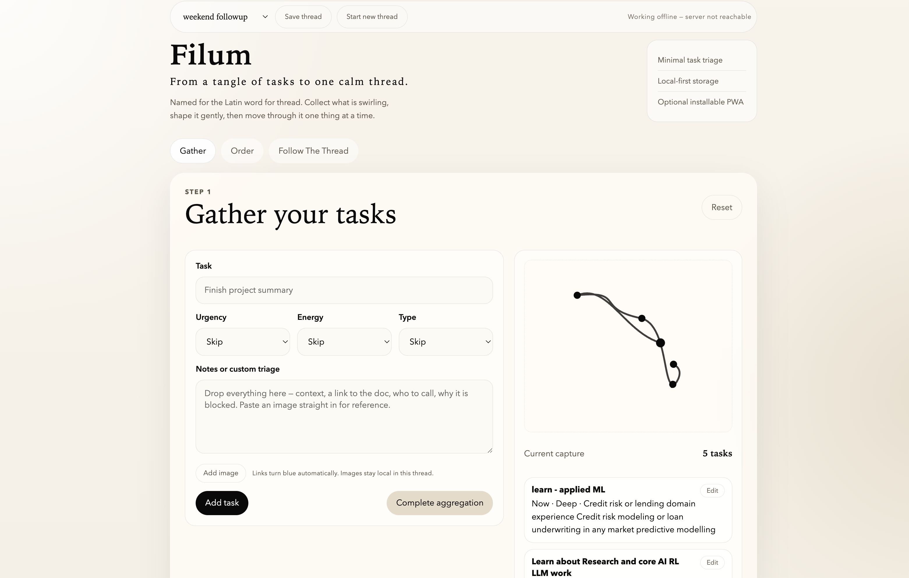

# Filum

Filum gives you a flow:

1. **Gather** — capture all the tasks currently occupying your mind.
2. **Choose the order** — move tasks into a usable sequence and optionally add rough durations.
3. **Follow the thread** — focus on one task at a time.

It is useful when you have too many competing tasks and need a calm, local, minimal way to convert them into a sequence.

## Circumspection

Circumspection is Filum's independent private writing space. Open it from the
compact book control in the top bar, or use the adjacent three strokes to open
the global Catalogue.

Writing is direct: text and the caret remain visible at input speed. A compact
rich-text bar stays above the diary, while task-note controls stay below the
input near the caret. Both provide bold, italic, underline, lists, and labelled
links without asking the writer to remember markup. Click any word to edit it
in place, including words on earlier leaves. Page breaks can be added at the
caret with **Turn the leaf** or `Cmd/Ctrl+Enter`. Entries have no titles and
remain independent from Filum threads.

Leaves keep their shape: each diary width holds a fixed number of lines, so
the same words always land on the same leaf. Editing in the middle of a full
leaf keeps you there while the overflow moves on; typing past the edge carries
you onto the next leaf, and the arrow keys walk across leaves the same way.
Type `1. ` or `- ` to start a list, and Tab / Shift+Tab to nest it (up to two
levels below the main point). A written leaf opens without a blinking caret —
click where you want to write, or just start typing to continue where you
left off. The → arrow on a written last leaf opens a fresh one.

The Catalogue is a wide typographic list: opening an entry reads and edits in
one place, while its bin control moves it to a recoverable local bin. Filum
keeps at most one blank entry and creates the next leaf only when writing
reaches it or the writer deliberately turns at the caret.

Basic defaults live in **Preferences**; **Personalise for me** opens the larger
customisation surface. The direct writing model uses `Ink effect: None`, with
no delayed reveal, blur, or post-text animation. Circumspection is
desktop/web-first; responsive mobile layouts remain available as a secondary
path.

### Exporting a diary to PDF

**Export PDF** (below a leaf) or the arrow-into-tray icon beside a Catalogue
entry opens the export sheet. Choose the leaves to keep — *from leaf i to leaf
j*, **All**, or **This leaf** — whether to begin with a title leaf (the date
the diary was begun, the range, when it was last written, its origin thread
and word count), and the paper: **Leaf shape** (the diary's own proportions),
**A4** or **US Letter**. The preview is the document itself, scaled down.

**Save as PDF…** opens the browser's print sheet: choose **Save as PDF**, then
a folder in Finder. The file is named after the diary (for example
`Circumspection — November 21, 2026 — leaves 3–7`). Leaves keep their
numbering and line breaks from the writing view, the type is embedded, text
stays selectable, links stay clickable, and abbreviations read in full.

## Abbreviations and images

Under **Preferences → Abbreviations**, add your own short forms (for example
`aca` → `also called as`). Wherever Filum shows text for reading — task
titles, notes, summaries — the full form appears; editors always keep exactly
what you typed.

Images attached to a task open in place when clicked. In a task's notes, type
`@` to reference one of that task's images alongside your threads.

## Following the thread

In **Retrospect**, click any completed task to read it — notes, images and
all — without bringing it back; "Return to thread" is there if you want it
again. A YouTube link in a task's notes shows a small preview that plays in
place only when you click it.

## A quick look



## Requirements

You need:

- Windows, macOS, or a Unix/Linux based system
- Node.js `18` or newer


## setup

### 1. Install system dependencies

install Node.js 18+ using your preferred method.

```bash
sudo apt install -y nodejs
node --version
```
Make sure the version is `v18.x` or newer.


On macOS with Homebrew:

```bash
brew install git node
node --version
```

On Windows with PowerShell and WinGet:

```powershell
winget install OpenJS.NodeJS.LTS
node --version
```

### 2. Clone the repository

```bash
git clone https://github.com/ManikSinghSarmaal/filum.git
cd filum
```

### 3. Run the local server

```bash
node server.js
```

You should see something like:

```text
[filum] serving on http://localhost:4317
[filum] threads at /home/<user>/.filum/threads
```

Now open the app in your browser:

```text
http://localhost:4317
```

## Storage

By default, Filum stores your saved threads here:

```bash
~/.filum/threads
```

Each thread is stored as a separate `.json` file.

Circumspection uses one independent global file and an offline browser mirror:

```text
~/.filum/circumspection.json
localStorage: filum:circumspection:v1
```

Deleting or archiving a thread does not delete its independent Circumspection
entries. Global Personalisation settings are stored in
`~/.filum/settings.json`.

Filum can optionally initialise a Git repository inside `~/.filum` from
**Personalise for me**. Only thread JSON in `threads/`, `archive/`, and `bin/`
is tracked. Each edit retains the original text date as its Git author date
while recording the actual save time as the committer date. Git is optional:
ordinary JSON persistence remains the source of truth and continues if Git is
unavailable.

To use a custom storage directory:

```bash
FILUM_THREADS_DIR=/path/to/my/filum-threads node server.js
```

Example:

```bash
mkdir -p ~/Documents/filum-threads
FILUM_THREADS_DIR=~/Documents/filum-threads node server.js
```

## Chrome Extension — Web Journey

Web Journey remembers how you found things. While researching, open the
Filum extension on any page: it shows the trail that led you there (a search,
the pages in between, the page in front of you), and pins it to a task in one
of your threads. From then on, pages you open in that tab are added to the
same trail until you close the tab. Later, in **Follow the thread**, a quiet
**✦ Web journey** button on the task opens the trail as a flowing thread;
hover any point to see the page's own description, how you arrived, and
anything you had highlighted. The extension does nothing until you open it,
shows no badges, and only ever talks to Filum on your own computer.

### Load it

1. Start Filum (`node server.js`).
2. Open `chrome://extensions` and turn on **Developer mode**.
3. Click **Load unpacked** and choose the `extension/` folder in this repo.
4. Pin **Filum — Web Journey** from the puzzle-piece menu if you like.

Chrome will mention reading browsing history: the extension uses it only to
rebuild a trail when you open the popup.

### Use it

1. On any page, click the Filum icon. The dot beside **Connected** is dark
   when Filum is reachable.
2. Check the trail preview, pick a **Thread**, then **Create new task** (the
   title is pre-filled from the page) or **Add to existing task**.
3. Optionally answer **What caught your eye?** Highlighted text on the page
   is saved automatically.
4. Press **✦ Capture to thread**. A line like
   `✦ web journey — 3 steps from Google: …` is added to the task's notes.

Trails can be renamed (hover the label, click ✎) or removed (**Remove this
trail**; undo brings it back).

### Server address

The popup uses `localhost:4317`. If you run Filum on another port, click
**Server** at the bottom of the popup and enter, for example,
`localhost:8080`. Only addresses on this computer are accepted.

## Custom port

The default port is `4317`.

To run Filum on another port:

```bash
FILUM_PORT=8080 node server.js
```

Then open:

```text
http://localhost:8080
```

You can combine custom port and custom storage:

```bash
FILUM_PORT=8080 FILUM_THREADS_DIR=~/Documents/filum-threads node server.js
```

## Optional: create a small launcher script

From inside the repo:

```bash
cat > run-filum.sh <<'SCRIPT'
#!/usr/bin/env bash
set -euo pipefail

cd "$(dirname "$0")"
node server.js
SCRIPT

chmod +x run-filum.sh
./run-filum.sh
```

Now you can start Filum with:

```bash
./run-filum.sh
```

## Optional: run Filum in the background

For a simple background run:

```bash
nohup node server.js > filum.log 2>&1 &
```

Check logs:

```bash
tail -f filum.log
```

Stop it:

```bash
pkill -f "node server.js"
```

### Optional: launchd service on macOS

If you want Filum to start automatically on login/boot on macOS, create a user `LaunchAgent`.

First, find your node binary path and current repo path:

```bash
which node
pwd
```

Ensure the `~/Library/LaunchAgents` directory exists:

```bash
mkdir -p ~/Library/LaunchAgents
```

Create the plist service file:

```bash
nano ~/Library/LaunchAgents/com.filum.server.plist
```

Paste the following, replacing:
- `/opt/homebrew/bin/node` with your actual node path (from `which node`)
- `/absolute/path/to/filum` with your actual repository path (from `pwd`):

```xml
<?xml version="1.0" encoding="UTF-8"?>
<!DOCTYPE plist PUBLIC "-//Apple//DTD PLIST 1.0//EN" "http://www.apple.com/DTDs/PropertyList-1.0.dtd">
<plist version="1.0">
<dict>
    <key>Label</key>
    <string>com.filum.server</string>

    <key>ProgramArguments</key>
    <array>
        <string>/opt/homebrew/bin/node</string>
        <string>server.js</string>
    </array>

    <key>WorkingDirectory</key>
    <string>/absolute/path/to/filum</string>

    <key>EnvironmentVariables</key>
    <dict>
        <key>FILUM_PORT</key>
        <string>4317</string>
        <key>PATH</key>
        <string>/usr/local/bin:/usr/bin:/bin:/usr/sbin:/sbin:/opt/homebrew/bin</string>
    </dict>

    <key>RunAtLoad</key>
    <true/>

    <key>KeepAlive</key>
    <true/>

    <key>StandardOutPath</key>
    <string>/tmp/filum.log</string>

    <key>StandardErrorPath</key>
    <string>/tmp/filum-error.log</string>
</dict>
</plist>
```

Load and start the service:

```bash
launchctl load -w ~/Library/LaunchAgents/com.filum.server.plist
```

Check logs:

```bash
tail -f /tmp/filum.log
```

To stop and disable it later:

```bash
launchctl unload -w ~/Library/LaunchAgents/com.filum.server.plist
```

## Optional: systemd service on Linux

If you want Filum to start automatically on boot, create a user-level systemd service.

First, get the absolute path of the repo:

```bash
pwd
```

Then create the service file:

```bash
mkdir -p ~/.config/systemd/user
nano ~/.config/systemd/user/filum.service
```

Paste this, replacing `/absolute/path/to/filum` with your actual repo path:

```ini
[Unit]
Description=Filum local thread server
After=network.target

[Service]
Type=simple
WorkingDirectory=/absolute/path/to/filum
ExecStart=/usr/bin/env node server.js
Restart=on-failure
Environment=FILUM_PORT=4317

[Install]
WantedBy=default.target
```

Enable and start it:

```bash
systemctl --user daemon-reload
systemctl --user enable --now filum.service
```

Check status:

```bash
systemctl --user status filum.service
```

View logs:

```bash
journalctl --user -u filum.service -f
```
